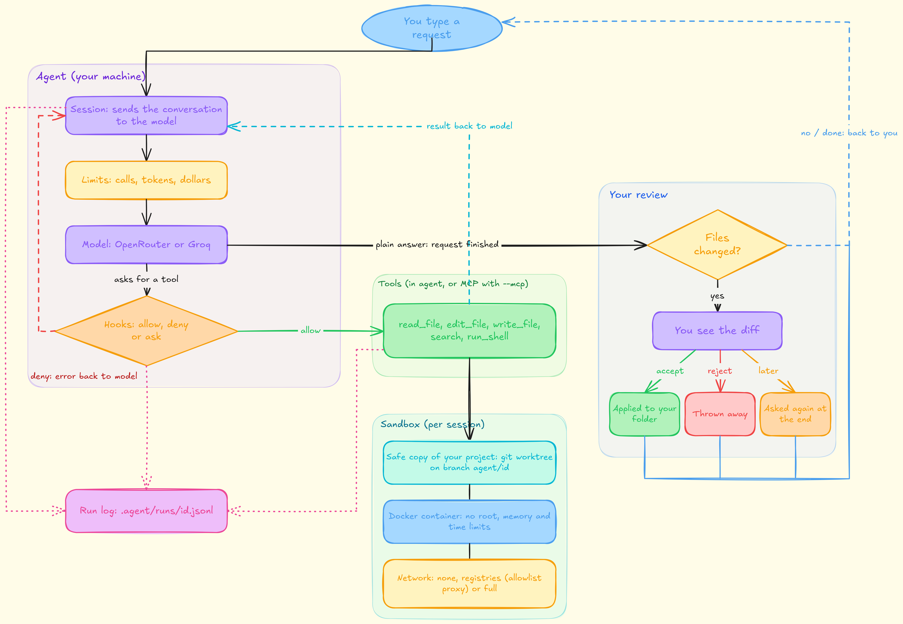

# ce-agent

A coding agent for the terminal. You point it at a git project and type what you want. It reads and edits code and runs commands in a safe copy of your project. Your real folder only changes when you accept the result.

It works with any OpenAI-compatible API, such as OpenRouter or Groq.

## How it works


Every step is written to the run log (dotted lines). The limits stop the loop if it runs too long. Details on the sandbox, MCP and cost limits are below.

**The safe copy.** Each session gets its own git worktree on a new branch. Your uncommitted work is included. Commands run in a Docker container with no network, no extra permissions, and limits on memory, processes and time.

**Network.** Off by default. `--network=registries` lets the container reach only the package sites you allow (for example PyPI). `--network=full` opens everything.

## Tools

| Tool | What it does |
|---|---|
| `list_files`, `search` | find files and text |
| `read_file` | read a file, or part of it |
| `edit_file` | replace one exact piece of text |
| `write_file` | create a new file (an existing file must be read first) |
| `run_shell` | run a command in the container |
| `git_diff` | see its own changes |
| `update_plan` | write the plan as a checklist |
| `remember` | save a fact to `AGENTS.md` for future sessions |

The tools can also run in a separate process over MCP: `--mcp` (stdio) or `--mcp=http`.

## Features

- **Sessions.** Keep sending requests; after each one that changes files you review the diff.
- **Memory.** `AGENTS.md` in your project is shown to the model at the start of every session.
- **Hooks.** Rules in `.agent/hooks.json` can allow, deny or ask before a tool runs. Built in: no recursive delete outside the project, no `curl | sh`, no `git push`.
- **Limits.** 20 model calls per request, plus per-session limits on calls, tokens and cost.
- **Status line.** After each step: `[plan 1/3: edit | turn 4/100 | context 5k/32k | tokens 12k/500k | $0.02/$5.00]`
- **Context.** When the conversation gets long, old tool output is cleared. The plan is kept.
- **Run log.** Everything is saved in `.agent/runs/<id>.jsonl`. Read it with `--show`.

## Try it

You need Python 3.11+, git and Docker (running).

```bash
git clone <this repo's URL> ce-agent
cd ce-agent
pip install .                      # installs the `ce-agent` command

cp .env.example .env               # then put one API key in .env
```

Make a small project to play with:

```bash
mkdir demo && cd demo && git init -q
echo 'def add(a, b): return a - b' > m.py
git add -A && git commit -qm start
cp ../.env .                       # the key is read from the folder you run in
```

Run it:

```bash
ce-agent . "add is wrong, fix it and check it by running it" --once
```

You will see each step the model takes, then the diff, then `[a]ccept / [r]eject / [k]eep branch`. Press `a` and `m.py` is fixed in your folder. The first run downloads the Docker image (`python:3.11-slim`), so it takes a little longer.

No Docker? Add `--unsafe-local`. Commands then run directly on your machine, so only use it on projects you trust.

## Use

```bash
ce-agent ~/myproject                          # interactive, Ctrl-D to finish and review
ce-agent ~/myproject "fix the failing test"   # start with a request
ce-agent ~/myproject "fix it" --once          # one request, then review

ce-agent ~/myproject --show [task_id]         # what did the agent do?
ce-agent ~/myproject --env                    # show the sandbox settings
ce-agent ~/myproject --cleanup                # after a crash
```

(`python -m ce_agent.main` works the same as `ce-agent`.)

Sandbox flags (use `=`, no space): `--network=none|registries|full`, `--image=`, `--memory=`, `--timeout=`, `--pids=`, `--allow-host=`, `--preset=python|node|rust|go`, `--no-cache`.

A folder that is not a git repo is fine: the agent offers to run `git init`.

To run the tests: `pip install ".[dev]" && python -m pytest tests` (Docker needed for the sandbox tests).

## Settings

| Variable | Default | Meaning |
|---|---|---|
| `PROVIDER` | `openrouter` | `openrouter` or `groq` |
| `MODEL` | per provider | model name |
| `MAX_TOKENS` | 4096 | longest single reply |
| `PROVIDER_ORDER` | unset | OpenRouter only: which backends to use, e.g. `Groq,AkashML` |
| `CONTEXT_TOKENS` | 32000 | context size the agent plans for |
| `SESSION_TOKEN_BUDGET` | 500000 | tokens per session |
| `SESSION_MAX_TURNS` | 100 | model calls per session |
| `MAX_COST_USD` | 5.0 | cost limit; needs `PRICE_IN_PER_M` and `PRICE_OUT_PER_M` (USD per million tokens) |

Settings come from the environment or from a `.env` file in the folder you run in (see `.env.example`).

Optional files in your project's `.agent/` folder: `env.json` (image, network, allowed hosts, limits) and `hooks.json` (rules).

## Code

```
ce_agent/
  main.py          command line, review
  session.py       the loop, plan, limits
  brain.py         talks to the model
  tools.py         the tools
  registry.py      turns tool functions into schemas for the model
  hooks.py         allow / deny / ask rules
  workspace.py     worktree, Docker container, accept and sync
  environment.py   sandbox settings
  egress.py, egress_proxy.py   the package-site allowlist
  context.py       keeps the conversation small
  trace.py         run log and --show
  mcp/             MCP protocol, stdio and HTTP transports, client, server
tests/
```
